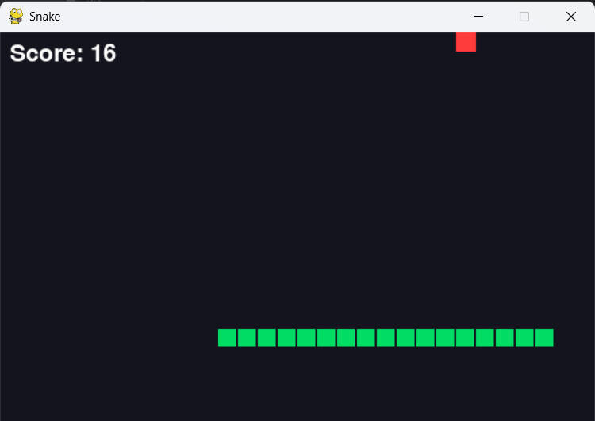

# 🐍 Snake Game

Classic Snake game made with Python and Pygame.
Part of the [PyFun](https://www.youtube.com/@PyFunGames) YouTube series: learn Python by building games.



## How to run

1. Install Python 3.10+
2. Install Pygame:
```
   pip install pygame
```
3. Run the game:
```
   python snake.py
```

## Controls

- Arrow keys: move the snake
- Eat the red food to grow and score
- Hitting the wall or yourself ends the game

## Video tutorial

Watch the full tutorial on [YouTube](https://www.youtube.com/@PyFunGames).

## License

MIT
